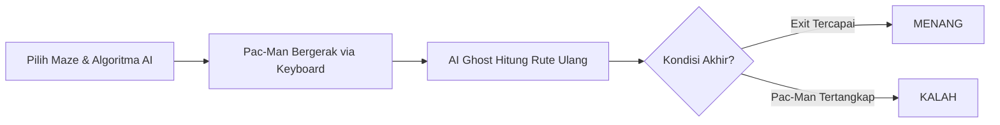

# 👾 Pac-Man: AI Pathfinding Benchmark (BFS vs A*)

[](#)
[](#)
[](#)

Dokumen ini merupakan **Game Design Document (GDD)** sekaligus spesifikasi teknis proyek tugas besar mata kuliah **Pengantar Kecerdasan Artifisial**, Institut Teknologi Kalimantan.

---

## 📋 Informasi Tim & Proyek

* **Mata Kuliah:** Pengantar Kecerdasan Artifisial
* **Dosen Pengampu:** Bima Prihasto, S.Si., M.Si., Ph.D.
* **Program Studi:** Informatika, Fakultas Sains dan Teknologi Informasi
* **Institusi:** Institut Teknologi Kalimantan

### Kelompok 5-B
| NIM | Nama Anggota |
| :---: | :--- |
| `11251064` | Anivah Mu'athiyah |
| `11251078` | Remarsya Fredericha |
| `11251086` | Andi Firaz Nadhir Baihaqi |
| `11251092` | Daniel Phillip Limbhoro |
| `11251094` | Huwaiza Ahmad Azfa |

---

## 📌 Ringkasan Eksekutif (Executive Summary)

* **Judul Proyek:** Analisis Perbandingan Kinerja Algoritma Breadth-First Search (BFS) dan $A^*$ pada AI Pengejar dalam Permainan Pac-Man
* **Genre:** 2D Grid-Based Arcade / Pathfinding Simulation
* **Platform:** PC / Desktop (Keyboard Control)
* **Tujuan Utama:** Membandingkan kinerja algoritma *Uninformed Search* (**BFS**) dan *Informed Search* (**$A^*$**) pada karakter hantu (*Ghost*) yang mengejar Pac-Man dalam lingkungan labirin 2D.

### 🔄 Core Loop Permainan



---

## 🎮 Aturan & Mekanisme Permainan (Gameplay Mechanics)

### 1. Karakter & Entitas
* **Pac-Man (Player):**
  * Dikendalikan pemain menggunakan keyboard (Tombol Panah / WASD).
  * Bergerak 4 arah (Atas, Bawah, Kiri, Kanan) dalam sistem grid 2D (tanpa pergerakan diagonal).
  * **Misi:** Mencapai titik pintu keluar (*exit*) sebelum tertangkap *Ghost*.
* **Ghost / Hantu (AI Character):**
  * Dikendalikan penuh oleh Agen AI.
  * Mengejar Pac-Man secara otomatis menggunakan algoritma pencarian pilihan pemain (**BFS** atau **$A^*$**).

### 2. Aturan Dasar Permainan
1. Karakter tidak dapat melompati atau menembus dinding (*obstacles*).
2. Pergerakan bersifat *4-directional* dengan *step cost* homogen ($g(n) = 1$ untuk setiap sel grid).
3. **Kondisi Menang (*Victory*):** Koordinat Pac-Man berada di titik *exit*.
4. **Kondisi Kalah (*Defeat*):** Koordinat *Ghost* menempati sel grid yang sama dengan Pac-Man (tertangkap).

---

## 🗺️ Desain Labirin (Maze Design)

Permainan menyediakan 3 opsi peta labirin untuk menguji efisiensi algoritma pada variasi kompleksitas geometri yang berbeda:

| Level | Fitur Geometri Labirin | Tujuan Pengujian AI |
| :--- | :--- | :--- |
| **Maze 1: Sedikit Belokan** | Area relatif terbuka dengan hambatan minimal. | Memeriksa performa dasar pencarian jalur langsung tanpa rintangan kompleks. |
| **Maze 2: Banyak Belokan** | Koridor padat dan berkelok-kelok tajam. | Memeriksa jumlah ekspansi simpul pada navigasi berbelok. |
| **Maze 3: Jalan Buntu** | Terdapat beberapa lorong mati (*dead-ends*). | Memuji efisiensi evaluasi heuristik agar AI menghindari eksplorasi jalur buntu. |

---

## 🤖 Spesifikasi Agen AI & Kerangka PEAS

Sistem AI pada *Ghost* dirancang menggunakan kerangka kerja **PEAS** (*Performance Measure, Environment, Actuators, Sensors*):

```
+-------------------------------------------------------------------------+
|                               SENSORS                                   |
| (Deteksi Posisi Ghost, Posisi Pac-Man, & Matriks Grid Labirin)          |
+-------------------------------------------------------------------------+
                                    │
                                    ▼
+-------------------------------------------------------------------------+
|                               AGEN AI                                   |
|               [ Algoritma Pilihan: BFS atau A* ]                        |
+-------------------------------------------------------------------------+
                                    │
                                    ▼
+-------------------------------------------------------------------------+
|                              ACTUATORS                                  |
|         (Eksekusi Pergerakan Ghost: Atas, Bawah, Kiri, Kanan)           |
+-------------------------------------------------------------------------+
```

### Tabel Komponen PEAS
* **Performance Measure:** Kecepatan waktu pencarian (*search time*), jumlah simpul yang diperiksa (*nodes explored*), dan efisiensi panjang jalur (*path length*).
* **Environment:** Grid 2D statis/dinamis (Jalur, Dinding, Exit, Pac-Man, dan Ghost).
* **Actuators:** Pergerakan fisik Ghost ke 4 arah mata angin pada grid.
* **Sensors:** Pembacaan titik koordinat Pac-Man, Ghost, serta representasi peta matriks labirin.

---

## 🧠 Algoritma Pathfinding

### 1. Breadth-First Search (BFS) — Uninformed Search
* **Prinsip:** Menelusuri seluruh simpul pada tingkat kedalaman saat ini sebelum berlanjut ke tingkat berikutnya (*level-by-level*).
* **Struktur Data:** Queue (FIFO).
* **Karakteristik:** Menjamin jalur terpendek dalam hal jumlah langkah pada grid berbobot seragam, tetapi cenderung memeriksa lebih banyak simpul.

### 2. $A^*$ (A-Star Search) — Informed Search
* **Prinsip:** Menentukan simpul terbaik berdasarkan fungsi evaluasi biaya minimum:
  $$f(n) = g(n) + h(n)$$
  * $g(n)$: Biaya aktual dari titik awal *Ghost* ke simpul $n$.
  * $h(n)$: Perkiraan biaya (heuristik) dari simpul $n$ ke target Pac-Man.
* **Fungsi Heuristik (Manhattan Distance):**
  $$h(n) = |x_n - x_t| + |y_n - y_t|$$
* **Struktur Data:** Priority Queue / Min-Heap.
* **Karakteristik:** Menggunakan informasi heuristik untuk mengarahkan pencarian langsung ke posisi target, mengurangi eksplorasi simpul yang tidak relevan.

### 3. Logika Dynamic Path Planning
Karena Pac-Man dikendalikan pemain dan berpindah koordinat, *Ghost* akan memicu kalkulasi ulang (*re-pathfinding*) setiap kali Pac-Man melangkah 1 kotak grid, menggunakan koordinat Ghost terbaru sebagai titik awal (*start*) dan koordinat Pac-Man terbaru sebagai titik tujuan (*goal*).

---

## 📊 Skenario & Parameter Pengujian Benchmark

### Skenario
1. **Pac-Man Diam (Static Target):** Mengukur efisiensi komputasi murni pencarian satu rute utuh dari titik *start* ke *goal*.
2. **Pac-Man Bergerak (Dynamic Target):** Mengukur performa pencarian dinamis saat rute dihitung berulang kali sepanjang sesi permainan.

### Parameter Evaluasi
* ⏱️ **Search Time (ms):** Waktu yang dibutuhkan algoritma untuk menyelesaikan komputasi rute.
* 🔍 **Nodes Explored:** Jumlah total simpul/kotak grid yang diperiksa selama proses pencarian.
* 📏 **Path Length:** Total langkah (*cost*) jalur solusi yang dihasilkan.
* 🏆 **Game Outcome:** Status akhir sesi permainan (Menang/Kalah) dan total waktu durasi main.

---

## 📅 Jadwal Pengerjaan Proyek

```gantt
title Timeline Pengerjaan Tugas Besar
dateFormat YYYY-MM-DD
section Perencanaan
Studi Literatur & Proposal       :done, 2026-10-15, 7d
Perancangan Maze & Mekanisme     :done, 2026-10-22, 14d
section Implementasi
Pergerakan Pac-Man & Ghost       :active, 2026-11-05, 14d
Implementasi BFS & A*            : 2026-11-12, 14d
section Pengujian & Laporan
Pengujian 3 Maze & 2 Kondisi     : 2026-11-19, 14d
Analisis Results & Refactoring   : 2026-11-26, 14d
Laporan Akhir & Finalization     : 2026-12-03, 7d
```

---

## 📄 Lisensi & Hak Cipta
Diikutsertakan sebagai bagian dari Tugas Besar Mata Kuliah **Pengantar Kecerdasan Artifisial (2026)** — Institut Teknologi Kalimantan.